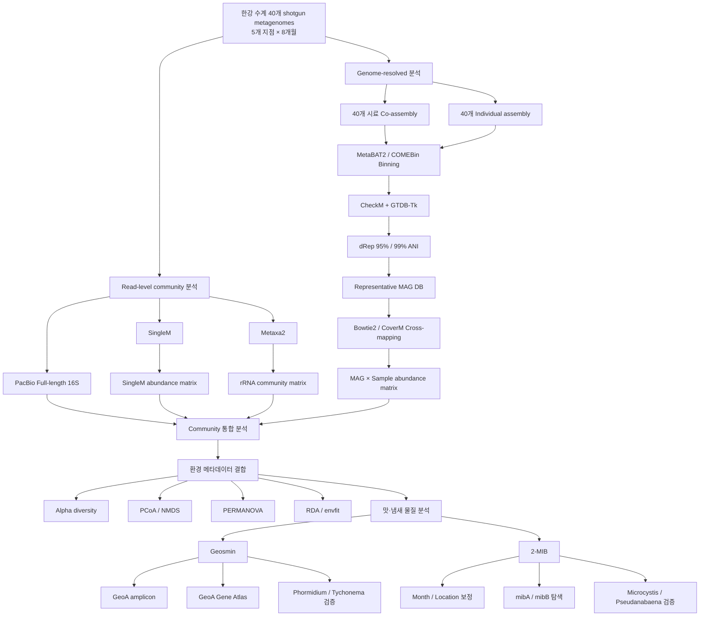
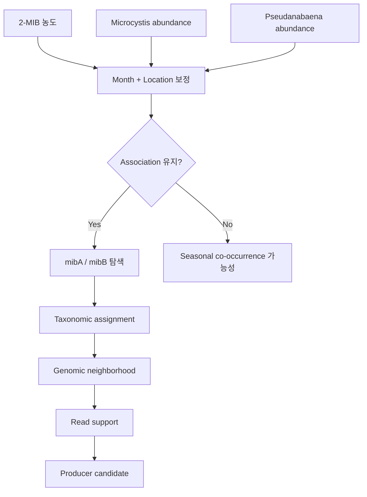

# 한강 수계 Freshwater Metagenomics Project

> 한강 수계 40개 메타지놈 시료를 이용하여 미생물 군집의 시공간적 변화, 대표 유전체(MAG), 환경인자, 그리고 Geosmin 및 2-MIB 발생과 연관된 미생물 및 기능 유전자를 통합적으로 분석하는 프로젝트입니다.

---

# 🔔 Latest Update

**최종 업데이트: 2026-11-08**

## 최근 완료한 작업

- [x] SingleM 분석 환경 및 GTDB reference metapackage 구축
- [x] 40개 shotgun metagenome 시료 SingleM profiling
- [x] 40개 시료별 SingleM taxonomy table 생성
- [x] 40개 시료별 Krona HTML 생성
- [x] SingleM 결과 통합 및 SampleID 정규화
- [x] 40개 환경 메타데이터와 SampleID 매칭
- [x] Phylum / Order / Genus / Species abundance matrix 생성
- [x] Alpha diversity 분석
- [x] Bray-Curtis 기반 PCoA / NMDS 분석
- [x] Location / Month 기반 PERMANOVA
- [x] RDA 및 NMDS envfit 분석
- [x] Geosmin-미생물 군집 상관분석
- [x] 2-MIB-미생물 군집 상관분석
- [x] SingleM downstream 분석용 reproducible Conda environment 구축

## 현재까지 주요 예비 결과

- **Month가 SingleM community variation의 42.1%를 설명**
- **Location이 28.4%를 설명**
- 따라서 현재 자료에서는 **지점 차이보다 계절 변화가 미생물 군집 구조를 더 크게 설명**
- 수온(Temperature)이 community structure와 가장 강한 환경적 연관성을 보임
- Geosmin은 전체 prokaryotic community structure와 상대적으로 약한 연관성을 보임
- 2-MIB는 Geosmin보다 훨씬 강한 community-level association을 보임
- *Microcystis*와 *Pseudanabaena*가 2-MIB와 강한 양의 상관관계를 보임
- 단, 2-MIB 관련 결과는 Month 및 Location 효과를 보정한 후 재검증 필요

## 바로 다음에 할 작업

1. 2-MIB와 *Microcystis* / *Pseudanabaena*의 관계에서 Month와 Location 효과 보정
2. PERMANOVA 결과에 대한 betadisper 결과 최종 확인
3. RDA 환경변수 간 multicollinearity 및 VIF 점검
4. Metaxa2를 이용한 shotgun rRNA profiling
5. dRep 95% / 99% ANI representative MAG 결과 확정
6. Representative MAG에 40개 시료 read 재매핑
7. SingleM / PacBio full-length 16S / Metaxa2 / MAG abundance 교차 검증
8. GeoA 결과와 SingleM community 결과 통합
9. Shotgun metagenome에서 `mibA` / `mibB` 직접 탐색

---

# 1. 연구 개요

본 프로젝트는 한강 수계의 미생물 군집 구조를 shotgun metagenomics, PacBio full-length 16S rRNA sequencing, genome-resolved metagenomics와 환경 메타데이터를 이용하여 분석하고, 특히 **Geosmin과 2-MIB 같은 맛·냄새 물질의 발생과 연관된 미생물과 기능 유전자**를 규명하는 것을 목표로 한다.

## 샘플링 설계

- 기간: 4월 ~ 11월
- 총 기간: 8개월
- 지점: 5개
  - GJ
  - UA
  - CP
  - SB
  - P2
- 매달 각 지점 1 sample
- 전체 시료 수: **5 × 8 = 40 samples**

## 환경 메타데이터

현재 40개 시료에 대해 다음 항목이 정리되어 있다.

- 수온
- pH
- 전기전도도
- DO
- SS
- TN
- TP
- TOC
- NH3-N
- NO3-N
- PO4-P
- Chl-a
- Geosmin
- 2-MIB
- Total plankton

---

# 2. 전체 분석 흐름



---

# 3. 분석 수행 구분

현재 프로젝트의 분석 작업은 크게 다음 세 부분으로 구분한다.

## 3.1 박병혁 박사님 선행 작업으로 전달받은 분석 자산

> **주의:** 아래 구분은 현재 전달받은 분석 파일 및 디렉터리 구조를 기준으로 정리한 것으로, 논문 Methods 또는 공식 보고서에 담당자를 명시하기 전에는 실제 분석 수행자를 최종 확인할 필요가 있다.

현재 프로젝트를 시작할 때 이미 확보되어 있던 주요 분석 자산은 다음과 같다.

### Sequencing 및 QC

- 40개 shotgun metagenome sequencing data
- QC 완료 read
- Sample별 paired FASTQ

### Assembly

- 40개 시료 MEGAHIT Co-assembly
- 40개 individual assembly
- 일부 MetaSPAdes assembly

### MAG reconstruction

- MetaBAT2 및/또는 COMEBin 결과
- CheckM 결과
- GTDB-Tk taxonomy 결과
- Co-assembly bin abundance 결과

### 기존 통합 테이블

`bin_table_combo`에서:

- Bin ID
- 시료별 abundance
- Completeness
- Contamination
- Strain heterogeneity
- GTDB-Tk classification
- ANI 관련 정보

등을 확인 가능하다.

### 기타 선행 분석

- Prodigal gene prediction
- eggNOG functional annotation
- geNomad virus/plasmid 분석
- PacBio full-length 16S 분석
- GeoA 관련 기존 amplicon 및 primer 분석 데이터

---

## 3.2 장경우가 새로 수행하거나 재구축한 분석

### MAG dereplication 환경 구축

- 4,026 MAG 파일 수집
- dRep용 CheckM table 변환
- MAG filename과 CheckM 결과 매칭 확인
- dRep dependency 설치 및 환경 점검
- `Prodigal`
- `Mash`
- `MUMmer`
- `FastANI`
- `skani`
- dRep 분석 스크립트 구성 및 troubleshooting

### SingleM 분석

- SingleM 전용 Conda environment 구축
- SingleM v0.21.4 설치
- GTDB r232 기반 metapackage 설치
- 59 SingleM marker package 확인
- 40개 시료 batch processing script 작성
- 40개 시료 profiling 완료
- Sample별 Krona 생성
- SingleM 결과 통합
- Metadata SampleID와 연결

### SingleM downstream 분석

- `singlem_downstream` Conda environment 구축
- Python / R 분석 환경 구성
- Taxonomy parsing
- Abundance matrix 생성
- Alpha diversity
- Bray-Curtis distance
- PCoA
- NMDS
- PERMANOVA
- betadisper
- RDA
- NMDS envfit
- Geosmin correlation
- 2-MIB correlation
- 자동화 master script 구축

---

## 3.3 앞으로 장경우가 진행할 분석

### Community analysis

- [ ] Metaxa2
- [ ] SingleM / Metaxa2 / PacBio 16S 교차 검증
- [ ] 주요 freshwater taxa 계절성 분석

### MAG analysis

- [ ] dRep 95% ANI 결과 확정
- [ ] dRep 99% ANI 결과 확정
- [ ] representative MAG taxonomy 확인
- [ ] representative MAG FASTA DB 구축
- [ ] Bowtie2 / CoverM read recruitment
- [ ] MAG × sample abundance matrix 구축

### Geosmin

- [ ] GeoA abundance와 Geosmin 농도 비교
- [ ] SingleM *Phormidium* / *Tychonema* abundance 비교
- [ ] PacBio / Metaxa2 결과와 비교
- [ ] GeoA Gene Atlas 구축

### 2-MIB

- [ ] Month / Location 보정 통계
- [ ] `mibA` screening
- [ ] `mibB` screening
- [ ] genomic neighborhood 분석
- [ ] 후보 producer taxonomy 확인
- [ ] *Microcystis* / *Pseudanabaena* association 검증

### ARG / MGE

- [ ] representative MAG 기반 ARG annotation
- [ ] plasmid-associated ARG 조사
- [ ] MAG-plasmid linkage
- [ ] geNomad 결과와 통합

---

# 4. 기존 Genome-resolved 분석

## 4.1 Co-assembly

40개 시료 전체에 대한 최종 선택 assembly:

```text
total_assembly_megahit_0402_01
```

MEGAHIT 주요 설정:

```bash
--min-count 3
--k-list 31,41,51,61,71,81,91,101,111,121,131
--mem-flag 1
```

Assembly 결과:

| 항목 | 결과 |
|---|---:|
| Total length | 29.34 Gbp |
| Total contigs | 43.37 M |
| Longest contig | 582,015 bp |
| N50 | 792 bp |

---

# 5. dRep Representative MAG 구축

## 현재 상태

**진행 중이며 최종 결과 검증 필요**

수집한 MAG:

```text
4,026 genomes
```

목표 quality filter:

```text
Completeness >= 50%
Contamination < 10%
```

Dereplication 기준:

```text
95% ANI → species-level representative MAG
99% ANI → strain-level representative MAG
```

CheckM 결과와 MAG 파일을 비교한 결과:

```text
MAG files           4,026
CheckM records      3,903
Missing records       123
```

따라서 **CheckM result가 없는 123 MAG는 임의로 representative MAG로 사용하지 않고 별도 QC가 필요하다.**

## 다음 확인 사항

- [ ] 95% ANI run 정상 종료 확인
- [ ] 99% ANI run 정상 종료 확인
- [ ] Representative genome 수 확인
- [ ] dRep clustering table 확인
- [ ] winner genome 품질 확인
- [ ] GTDB-Tk taxonomy와 연결
- [ ] 123개 QC 누락 MAG 처리

---

# 6. SingleM 분석

## 목적

MAG 기반 community analysis에서는 다음 문제가 존재할 수 있다.

- Low-abundance organism의 assembly 실패
- fragmented contig
- unbinned community
- microdiversity에 따른 MAG 복원 실패

따라서 assembly 없이 QC read에서 marker gene을 직접 검출하는 SingleM을 사용하여 community profile을 별도로 구축하였다.

## Software

```text
SingleM       v0.21.4
Metapackage   S6.5.0
Taxonomy      GTDB r232
Marker        59 SingleM packages
```

## Thread 사용에 대한 정리

Batch script에서는:

```bash
--threads 30
```

을 지정하였다.

실제 SingleM 로그에서 내부 DIAMOND 명령은:

```bash
diamond blastx --threads 30
```

으로 실행된 것이 확인되었다.

따라서 SingleM 분석을 **완전히 single-thread로 실행했다고 보는 것은 정확하지 않다.**

정확한 표현은 다음과 같다.

> SingleM 실행 시 30 threads를 요청하였으며, 내부 DIAMOND search 단계에는 실제로 30 threads가 전달되었다. 다만 SingleM의 모든 내부 단계가 항상 30 CPU core를 사용하는 것은 아니며, 작업 단계에 따라 CPU utilization이 달라질 수 있다.

또한 40개 sample은 동시에 실행하지 않고:

```text
Sample 1
  ↓
Sample 2
  ↓
Sample 3
  ↓
...
Sample 40
```

형태로 **순차 실행**하였다.

즉:

```text
Sample-level parallelization: 사용하지 않음
DIAMOND internal threading: 30 threads
SingleM internal stages: stage-dependent
```

---

## SingleM 실행 결과

```text
Total samples : 40
Success       : 40
Failed        : 0
```

각 시료에서:

```text
<SAMPLE>_singlem.tsv
<SAMPLE>_krona.html
```

생성.

통합:

```text
all_singlem.tsv
```

SampleID 수정 후:

```text
all_singlem_sampleid_fixed.tsv
```

40개 metadata SampleID와 모두 정확히 일치함을 확인하였다.

---

# 7. SingleM Downstream 분석

별도 환경:

```bash
conda activate singlem_downstream
```

분석 대상 taxonomy:

```text
Domain
Phylum
Class
Order
Family
Genus
Species
```

SingleM 결과에는 일부 Eukaryota도 포함되어 있으므로 주요 community ecology 분석에서는:

```text
Bacteria + Archaea
```

를 이용한 prokaryotic profile을 별도로 사용하였다.

---

# 8. Genus matrix

초기 genus-level taxa:

```text
21,568
```

Filtering 기준:

```text
relative abundance >= 0.1%
in at least 4 samples
```

Filtered genus:

```text
270
```

원본 matrix는 보존하고, filtered matrix를 visualization 및 correlation 분석에 사용하였다.

---

# 9. Alpha diversity

Genus-level profile에서:

- Detected genera
- Shannon index
- Simpson index

계산.

결과:

| 지표 | 평균 | 최소 | 최대 |
|---|---:|---:|---:|
| Shannon | 5.012 | 4.165 | 5.819 |
| Simpson | 0.973 | 0.939 | 0.990 |

SingleM marker profile 기반 값이므로 **절대적인 ecosystem species richness로 해석하지 않고 시료 간 상대 비교에 사용한다.**

---

# 10. Beta diversity

Bray-Curtis dissimilarity를 사용하였다.

분석:

- PCoA
- NMDS

NMDS:

```text
Stress = 0.1137
```

---

# 11. PERMANOVA

Model:

```text
Community ~ Location + Month
```

결과:

| 변수 | R² | P |
|---|---:|---:|
| Month | **0.421** | **0.001** |
| Location | **0.284** | **0.001** |
| Residual | 0.295 | |

## 현재 해석

```text
Month > Location
```

즉 현재 SingleM 결과에서는 **계절 변화가 지점 차이보다 microbial community structure를 더 크게 설명한다.**

단, PERMANOVA의 차이가 group dispersion 차이에 의한 것인지 확인하기 위해 betadisper 결과를 함께 검토해야 한다.

---

# 12. RDA / 환경 변수

RDA에서 유의했던 변수:

| 환경 변수 | P |
|---|---:|
| Temperature | 0.001 |
| pH | 0.007 |
| Electrical conductivity | 0.001 |
| SS | 0.001 |
| TN | 0.005 |
| PO4-P | 0.031 |
| Chl-a | 0.002 |
| 2-MIB | 0.026 |

Geosmin:

```text
p = 0.174
```

으로 RDA에서는 유의하지 않았다.

---

# 13. NMDS envfit

수온이 가장 강한 community association을 나타냈다.

```text
Temperature

R² = 0.769
FDR = 0.002
```

현재 결과는 한강 수계 microbial community turnover에서:

```text
Season
+
Temperature
+
Nutrient gradient
```

가 매우 중요한 요인일 가능성을 보여준다.

---

# 14. Geosmin association

Genus abundance와 Geosmin의 Spearman correlation 후 BH-FDR 보정을 수행하였다.

```text
FDR < 0.05 genera = 6
```

가장 강한 association:

```text
ZC4RG30

rho = -0.661
FDR = 9.37e-4
```

RDA에서 Geosmin 자체가 유의하지 않았고 전체 270 filtered genera 중 유의 taxon도 6개에 불과하였다.

## Working interpretation

Geosmin은 전체 bacterial community가 광범위하게 변화해서 발생한다기보다는:

```text
특정 producer population
        ↓
geoA
        ↓
Geosmin
```

형태일 가능성을 검토 중이다.

이 결과는 correlation 결과이며 **해당 genus가 Geosmin producer라는 직접적인 증거는 아니다.**

---

# 15. 2-MIB association

2-MIB에서는:

```text
FDR < 0.05 genera = 151
```

으로 훨씬 많은 community association이 확인되었다.

주요 후보:

### Microcystis

```text
rho = 0.805
FDR = 9.27 × 10^-9
```

### Pseudanabaena

```text
rho = 0.785
FDR = 3.38 × 10^-8
```

## 중요한 해석상의 주의점

Month가 community variation의:

```text
42.1%
```

를 설명한다.

따라서 현재 관찰되는:

```text
2-MIB ↔ Microcystis
2-MIB ↔ Pseudanabaena
```

association은:

```text
Month
  ├── 2-MIB 변화
  └── Community 변화
```

라는 공통 계절성에 의한 결과일 수도 있다.

따라서 현재 단계에서 해당 taxa를 **2-MIB producer라고 결론 내리지 않는다.**

---

# 16. 향후 2-MIB 검증 전략



---

# 17. GeoA 분석과 통합

기존 GeoA amplicon 재분석에서는:

```text
Oscillatoriales    91.9%
Nostocales          4.3%
Kitasatosporales    3.8%
```

Genus level:

```text
Phormidium       58.1%
Tychonema        28.9%
Oscillatoria      4.9%
Streptomyces      3.8%
Aphanizomenon     3.6%
Dolichospermum    0.5%
Nostoc            0.2%
```

따라서 향후에는 각 SampleID에서:

```text
Geosmin concentration
        +
GeoA abundance
        +
Phormidium abundance
        +
Tychonema abundance
        +
SingleM abundance
        +
PacBio 16S
        +
Metaxa2
```

를 직접 비교한다.

---

# 18. 다음 우선순위

## Priority 1. 현재 SingleM 통계 검증

- [ ] Month betadisper 확인
- [ ] Location betadisper 확인
- [ ] PERMANOVA 해석 확정
- [ ] RDA global significance 확인
- [ ] 환경변수 multicollinearity 확인
- [ ] VIF 계산

## Priority 2. 2-MIB confounding 제거

- [ ] Month 보정
- [ ] Location 보정
- [ ] Partial correlation
- [ ] adjusted regression model
- [ ] *Microcystis* 재검증
- [ ] *Pseudanabaena* 재검증

## Priority 3. Metaxa2

```text
SingleM
    +
Metaxa2
    +
PacBio full-length 16S
```

3가지 독립적인 community profiling 결과를 비교한다.

## Priority 4. dRep

- [ ] 95% ANI representative MAG
- [ ] 99% ANI representative MAG
- [ ] GTDB-Tk taxonomy 연결
- [ ] Representative FASTA DB 구축

## Priority 5. MAG abundance

```text
Representative MAG
        +
40 sample reads
        ↓
Bowtie2 / CoverM
        ↓
MAG × sample abundance
```

## Priority 6. GeoA

- [ ] `geoA` 정밀 DB
- [ ] GeoA Gene Atlas
- [ ] *Phormidium*
- [ ] *Tychonema*
- [ ] Geosmin concentration
- [ ] Community profile 통합

## Priority 7. 2-MIB functional gene

- [ ] `mibA`
- [ ] `mibB`
- [ ] Taxonomy
- [ ] Genomic context
- [ ] Environmental abundance

## Priority 8. MGE / ARG

- [ ] Representative MAG ARG annotation
- [ ] Plasmid ARG
- [ ] MAG-plasmid linkage
- [ ] geNomad result integration

---

# 19. 현재 Working Hypothesis

## 전체 미생물 군집

```text
계절 변화
   ↓
수온 변화
   ↓
영양염 및 수질 변화
   ↓
Microbial community turnover
```

## Geosmin

```text
특정 producer population
        ↓
geoA
        ↓
Phormidium / Tychonema
        ↓
Geosmin
```

## 2-MIB

```text
계절 환경 변화
        ↓
Cyanobacteria 및 community 변화
        ↓
Microcystis / Pseudanabaena association
        ↓
2-MIB
```

단, 2-MIB 모델은 아직 **association hypothesis** 단계이며 Month/Location 보정 및 `mibA/mibB` 확인이 필요하다.

---

# 20. GitHub 저장소 구성 계획

```text
han-river-metagenomics/
│
├── README.md
│
├── docs/
│   ├── project_overview.md
│   ├── assembly.md
│   ├── mag_binning.md
│   ├── singlem.md
│   ├── singlem_downstream.md
│   ├── geoa.md
│   ├── mge_virome.md
│   └── future_work.md
│
├── workflow/
│   ├── drep/
│   │   └── run_drep.sh
│   │
│   ├── singlem/
│   │   ├── run_singlem_all.sh
│   │   └── run_singlem_downstream.sh
│   │
│   ├── metaxa2/
│   ├── coverm/
│   └── functional_genes/
│
├── config/
│   └── singlem_downstream_environment.yml
│
├── results_summary/
│   ├── assembly_summary.tsv
│   ├── mag_summary.tsv
│   ├── singlem_summary.tsv
│   ├── permanova_summary.tsv
│   ├── rda_summary.tsv
│   └── odor_compound_summary.tsv
│
├── figures/
│   ├── community_composition/
│   ├── diversity/
│   ├── environmental_association/
│   └── geosmin_2mib/
│
└── CHANGELOG.md
```

FASTQ, BAM, assembly FASTA, 전체 MAG FASTA, GTDB/SingleM database 등 대용량 데이터는 GitHub에 올리지 않는다.

GitHub에는:

```text
분석 코드
환경 설정
README
요약 TSV/CSV
최종 figure
Methods 기록
```

위주로 관리한다.

---

# 21. 분석 환경 및 재현성

## Conda environments

```text
p2-GJ
singlem
singlem_downstream
```

## SingleM

```text
SingleM v0.21.4
Metapackage S6.5.0
GTDB r232
```

## 주요 분석 스크립트

```text
run_drep.sh
run_singlem_all.sh
run_singlem_downstream.sh
```

## Downstream 환경 재생성

```bash
conda env create \
  -f singlem_downstream_environment.yml
```

---

# 22. 분석 진행 기록

## 2026-10-16

- dRep 환경 구성 및 troubleshooting
- 4,026 MAG 수집
- MAG / CheckM table 비교
- 123개 CheckM missing MAG 확인
- dRep dependency 점검

## 2026-10-17

- SingleM v0.21.4 설치
- SingleM S6.5.0 metapackage 다운로드
- GTDB r232 확인
- 59 marker package 확인

## 2026-10-18

- 40개 시료 SingleM batch profiling 완료
- 성공: 40
- 실패: 0
- 각 시료 Krona 생성

## 2026-10-19

- `singlem_downstream` environment 구축
- 40개 SingleM result 통합
- Metadata와 SampleID 매칭
- Taxonomy matrix 생성
- Alpha diversity 분석
- PCoA / NMDS
- PERMANOVA
- RDA
- envfit
- Geosmin correlation
- 2-MIB correlation

## 2026-11-08

- SingleM 결과 및 downstream 분석 정리
- 기존 분석 / 신규 분석 / 향후 분석 구분
- 현재 working hypothesis 정리
- GitHub README 기반 지속적 연구 진행 기록 체계 구축
